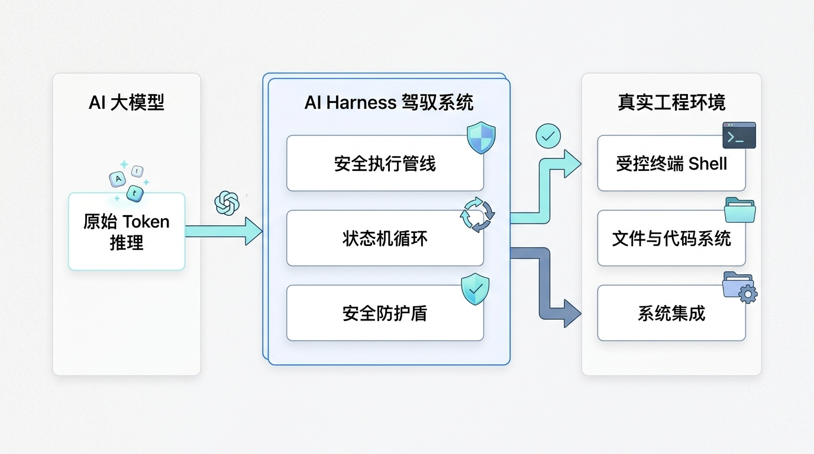
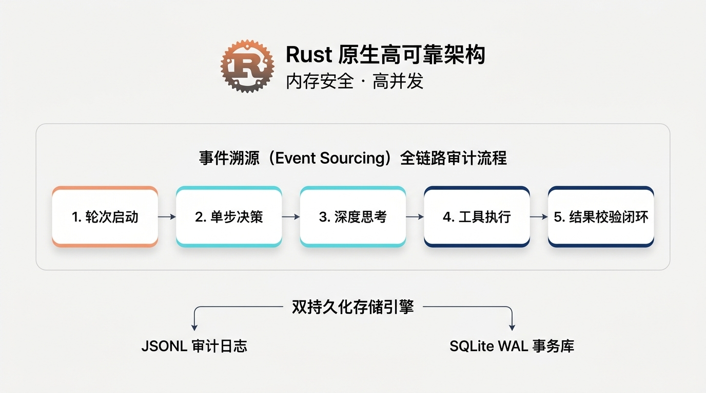
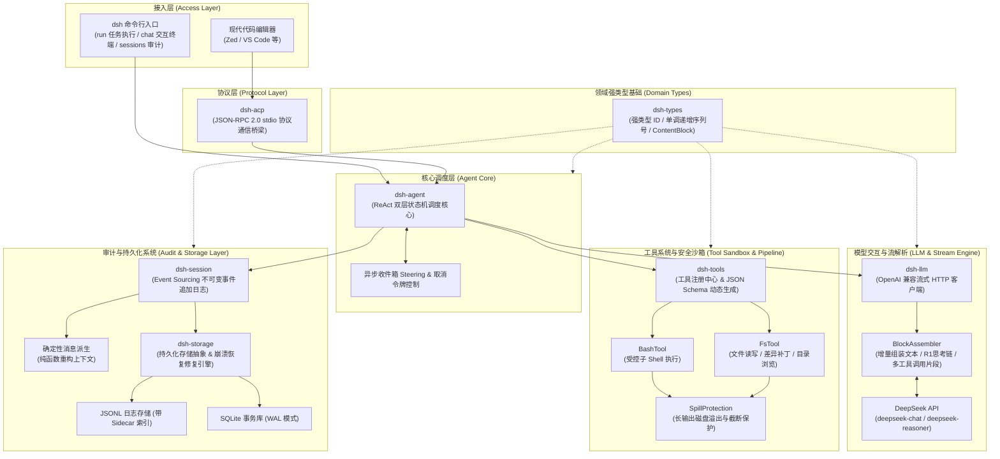

# DeepSeek Harness (Rust)

DeepSeek Harness 是一个使用纯 Rust 构建的工业级原生 ReAct Agent 运行载具与交互驾驭系统。项目深度适配 DeepSeek 系列大模型（包括 DeepSeek-V3 与具备深度思考能力的 DeepSeek-R1），面向自主编码、任务自动化及现代编辑器智能集成等场景，提供高确定性、高并发、内存安全与全链路可追溯的系统级底层支持。

---

## 为什么需要 AI Harness？（大模型时代的关键基石）



在当前的大模型技术浪潮中，很多人容易产生一种误解：**“只要模型参数足够大、推理能力足够强，一切问题就自然迎刃而解”**。

现实的工程实践并非如此。大模型（LLM）本质是一个离散的概率预测引擎（Token 输入与预测输出），它好比一台性能强劲的“发动机”或一个脱离了身体的“离散大脑”。纯粹的 API 交互无法直接落地为稳定、可靠的复杂软件工程能力：

1. **状态断层与长程推理**：模型本身完全无状态。现实软件工程需要多步骤递进（探索、读取、修改、编译、报错、修复），面对动辄数十步的推理链路，如何管理上下文生命周期、避免历史污染和状态漂移？
2. **现实环境隔离与执行安全**：模型输出的只是文本，它本身不能敲命令、改源码、跑单元测试。必须有一套安全、受控的运行时工具沙箱，实现与宿主操作系统环境的严密交互。
3. **上下文窗口溢出风险**：现实开发中一条命令输出可能包含几十万行编译日志或报错栈，若直接塞入上下文，瞬间就会撑爆模型的上下文窗口（Context Window），导致流程中断或严重幻觉。
4. **流式碎片与复杂多工具重组**：如 DeepSeek-R1 的思考链（Reasoning / Thinking）和工具调用（Tool Calls），在网络流式传输中是以高度碎片化的切片到达的，缺少稳健的组装系统将极易丢失关键指令。
5. **系统容灾与确定性**：网络抖动、进程中断、电源故障等突发异常下，如何保证长程任务不留脏状态？如何恢复未完成的会话断点？

这就是 **Harness（马具 / 驾驭载具）** 系统的核心价值所在。

正如业界标杆实践中：**OpenAI Codex** 之所以能将模型代码能力转化为实用的代码编写体验，**Claude**（如 Claude Code、Claude Artifacts、Computer Use Harness 等系统）之所以能在复杂长程任务中表现出惊人的工程落地能力，关键不仅在于底层模型权重，更在于其背后打磨极其精良的 Harness 载具系统。

**Harness 是将大模型的原始智能安全、可控、高质量投射到真实世界操作系统与工程环境的必要载具。没有可靠的 Harness，大模型只是纸上谈兵。**

---

## 本工程核心特色



DeepSeek Harness 针对现有主流基于 Python 或 Node.js 的 Agent 框架在长时间运行下的内存泄漏、运行时类型错误、并发阻塞和黑盒不可控等痛点，进行了彻底的原生重构：

### 1. 全 Rust 自主研发与原生系统可靠性
- **零黑盒运行时负担**：完全基于纯异步 Rust 和 Tokio 运行时，不依赖 Python 解释器或任何重量级中间件。
- **编译期类型安全与生命周期保障**：借助 Rust 严格的所有权模型与强类型体系（如显式 `Result`/`Option` 错误处理），从根源杜绝空指针异常、未捕获运行时错误以及数据竞争，确保高并发环境下的强确定性与长期稳定驻留。
- **极致资源利用效率**：极低的内存占用与纳秒级响应开销，适合嵌入 CLI、开发机后台守护进程或资源受限的边缘环境。

### 2. 全链路跟踪与每一步交互的严密审计
- **事件溯源（Event Sourcing）核心**：系统对所有的会话变更采取不可变事件追加日志（Append-only Event Log）机制。从任务轮次边界（Turn）、ReAct 单步决策（Step）、用户输入、模型回复、思考链（Reasoning Process）、工具调用参数到执行结果与输出截断，全部作为强类型事件持久化记录。
- **上下文纯函数派生**：传给 DeepSeek 模型的历史消息上下文绝非易碎的可变快照，而是基于不可变事件流纯函数确定性重构生成，杜绝状态不一致风险。
- **工业级故障恢复（Crash Recovery）**：提供 JSONL（含边车元数据）与 SQLite（WAL 预写日志与事务保护）双存储后端。内置恢复引擎能在遭遇掉电或异常中断时，自动扫描未闭合的单步与轮次，合成安全边界，保障审计记录分毫不差。

### 3. 长输出磁盘溢出截断保护（Spill Protection）
- 内置 Bash 子 Shell 与文件系统工具，当执行结果超过预设阈值时，自动触发磁盘溢出隔离机制，将完整数据转存至安全临时文件，仅在模型上下文中呈现提要与截断预览，彻底解决上下文窗口超限隐患。

### 4. 深度适配 DeepSeek 思考链与多工具调用
- 内建增量流状态机（BlockAssembler），能够无损实时组装包含普通文本切片、DeepSeek-R1 深度思考链（`reasoning_content`）以及并行工具调用片段，支持终端实时流式打字机回显。

### 5. 标准协议与生态兼容
- 原生支持 Agent Client Protocol (ACP) 标准协议（基于 stdio 的 JSON-RPC 2.0），可直接作为后端驱动 Zed、VS Code 等现代代码编辑器，实现零门槛编辑器接入。

---

## 架构设计

系统采用分层解耦的模块化架构，各个模块边界清晰、职责明确：



---

## 模块功能概览

本项目采用 Cargo Workspace 架构进行清晰的物理与逻辑分层：

| Crate 模块 | 功能说明 |
|---|---|
| `dsh-types` | **领域强类型基础库**：定义统一的核心标识（会话 ID、步骤 ID、轮次 ID、工具调用 ID）、单调递增序列号以及内容块模型（文本、思考链、工具调用、工具结果），保证系统底层契约一致。 |
| `dsh-session` | **事件溯源核心库**：承载以不可变事件日志为核心的状态记录模型，负责处理事件序列校验，并通过纯函数算法将事件流无损派生为大模型上下文消息。 |
| `dsh-llm` | **模型交互与流式组装器**：封装与 DeepSeek API 的异步流式网络通信，内置流式块组装状态机，负责将分片的文本增量、深度思考过程与工具调用碎片拼装为完整对象。 |
| `dsh-tools` | **工具注册与沙箱管线**：提供工具特征抽象、参数模式导出、受控 Bash 命令执行、文件系统操作，以及针对大规模输出的磁盘溢出截断保护机制。 |
| `dsh-agent` | **ReAct 循环调度核心**：实现驱动 Agent 自主运转的 Turn 与 Step 双层状态机，协调多轮交互调度、外部输入排队注入以及安全的中断取消机制。 |
| `dsh-storage` | **持久化存储与崩溃修复**：提供高性能 JSONL 与 SQLite WAL 事务持久化后端，内置崩溃检测与一致性修复引擎，在系统突发中断后重建完整的状态边界。 |
| `dsh-acp` | **编辑器协议服务端**：实现标准 Agent Client Protocol（JSON-RPC 2.0 over stdio），将底层 Agent 能力暴露给 Zed、VS Code 等现代代码编辑器使用。 |
| `dsh-cli` | **统一命令行主入口**：构建最终的 `dsh` 二进制工具，提供单任务直接执行、交互式终端结对会话、ACP 服务启动及历史会话审计等子命令。 |

---

## 简要使用说明

### 1. 环境准备

配置 DeepSeek 接口地址与鉴权密钥：

```bash
export OPENAI_BASE_URL="https://api.deepseek.com"
export OPENAI_API_KEY="sk-your-deepseek-api-key"
export MODEL="deepseek-chat" # 亦可指定为 deepseek-reasoner 启用 R1 深度思考模式
```

### 2. 编译构建

使用 Cargo 编译高优化版本的 Release 可执行文件：

```bash
cargo build --release -p dsh-cli
```

编译完成后，可执行程序位于 `target/release/dsh`。

### 3. 命令使用

#### 自动化单任务执行 (`dsh run`)

无需人工干预，直接在终端中让 Agent 针对明确目标自主规划、编写代码、调用工具并验证结果：

```bash
./target/release/dsh run "创建一个 helloworld.c 文件，使用 gcc 编译并执行，最后汇报运行结果。"
```

#### 终端交互式会话 (`dsh chat`)

启动沉浸式交互终端，与 DeepSeek 模型开展多轮结对编程，支持实时打字机回显与工具执行状态观察：

```bash
./target/release/dsh chat
```

#### 现代编辑器接入 (`dsh acp`)

启动基于标准输入输出的 ACP 协议服务：

```bash
./target/release/dsh acp
```

以 Zed 编辑器为例，在 `settings.json` 中配置自定义 Agent 后端即可原生唤起使用：

```json
{
  "agent": {
    "command": "dsh",
    "args": ["acp"]
  }
}
```

#### 历史会话审计与检查 (`dsh sessions`)

查看系统本地持久化记录的会话清单、对应事件日志及状态诊断路径：

```bash
./target/release/dsh sessions
```

### 4. 自动化测试

运行工作区内的完整测试套件，验证类型契约、流重组逻辑、工具沙箱溢出与 SQLite 崩溃恢复机制：

```bash
cargo test
```

---

## 开源协议

本项目采用 MIT License 开源许可协议。
